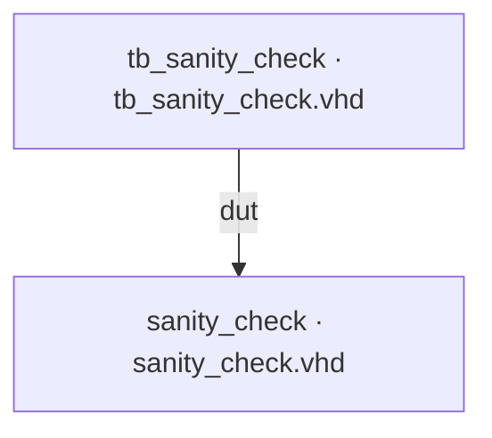

# Codemap: vHDL-mini-project

← [README](README.md)

> Generated from commit `856a276` by `scripts/codemap.py`. Regenerate it from the workspace root with `python3 scripts/codemap.py vHDL-mini-project`; don't edit it by hand.

## Design

### `sanity_check` (`sanity_check.vhd`)

- **In:** `i_a`, `i_b`, `i_cin`
- **Out:** `o_s`, `o_cout`, `o_cout_s_a`

### `tb_sanity_check` (`tb_sanity_check.vhd`)

- **In:** -
- **Out:** -
