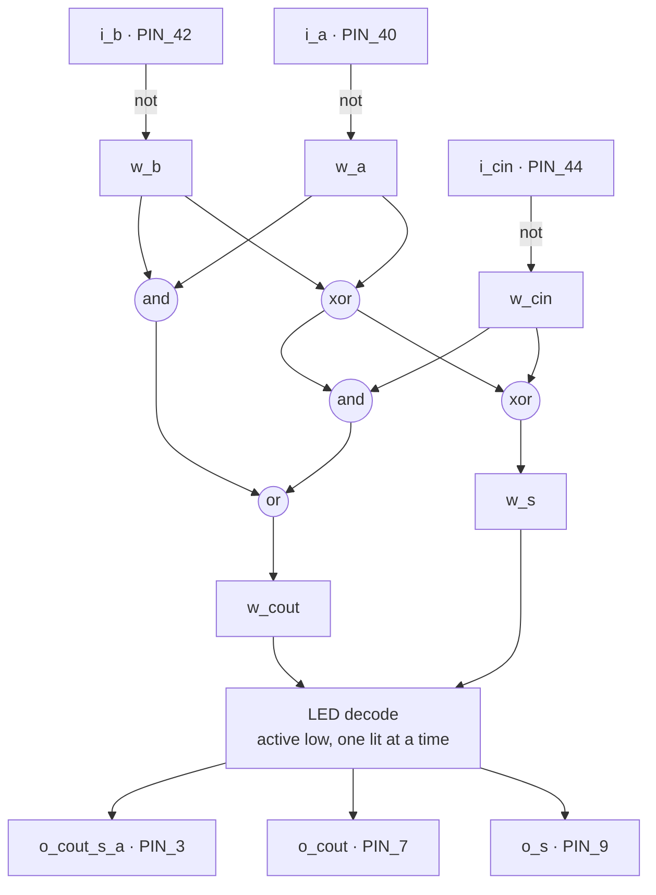

# vHDL-mini-project

> A full adder on the Cyclone II: the first-synthesis sanity check, from jumper wires to three LEDs.


## Overview

`sanity_check.vhd` is a one-bit full adder wired to real pins: proof that the board, the toolchain and the pin plan all work before anything bigger. The interesting part is physical, not logical. **Every input is inverted on entry**, because an unconnected jumper floats high through the pull-up: a signal reads `1` only when it is actually tied to ground.

## Architecture



## Truth Table

Inputs read `1` when the jumper goes to ground. Exactly one LED lights for any non-zero sum:

| a + b + cin | sum | carry | LED lit |
|---|---|---|---|
| 0 | 0 | 0 | none |
| 1 | 1 | 0 | `o_s` |
| 2 | 0 | 1 | `o_cout` |
| 3 | 1 | 1 | `o_cout_s_a` |

Checked exhaustively in GHDL (all 8 input combinations).

## Build

```bash
# Quartus 13.0sp1: open sanity_check.qpf (or restore sanity_check.qar), compile, program over USB-Blaster
ghdl -a --std=08 sanity_check.vhd   # analyze only; there's no testbench in the repo
```

The pins live in `sanity_check.qsf`, with weak pull-ups on all three inputs. *(The comments in `sanity_check.vhd` have `o_s` and `o_cout_s_a` swapped: PIN_9 and PIN_3 above are what the `.qsf` actually assigns.)*

**Codemap:** [CODEMAP.md](CODEMAP.md), the entities, ports and processes, generated from the code.

---
*powered by logic, coffee, and many sleepless nights*
